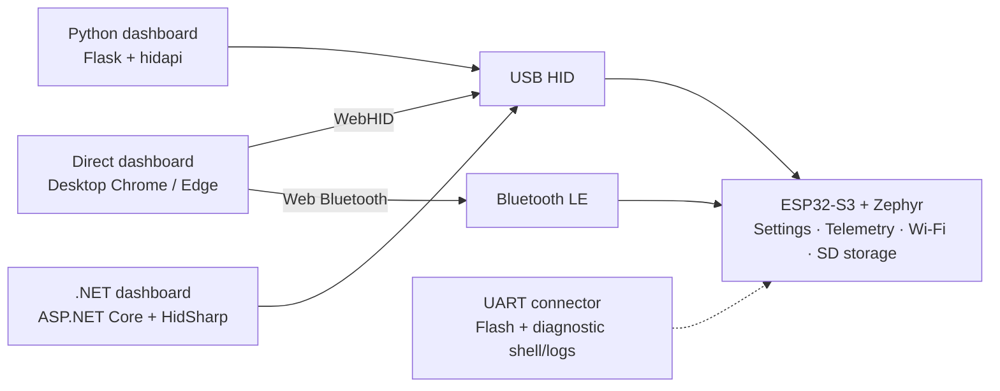

# ESPForge

[](https://github.com/djwinter29-oss/ESPForge/actions/workflows/pr-check.yml)
[](https://github.com/djwinter29-oss/ESPForge/actions/workflows/release.yml)
[](LICENSE)


**A Zephyr foundation for your ESP32-S3 product, with board management already in place.**

ESPForge provides board identity, diagnostics, persistent settings, wireless provisioning, optional SD storage
and host tools, so you can focus on your application's hardware and behavior. Its Direct, Python and .NET
dashboards help you bring up the board and keep management separate from product-specific work.

It shares [PicoForge](https://github.com/djwinter29-oss/PicoForge)'s intent: provide the supporting firmware and
host tooling that downstream products would otherwise rebuild. ESPForge applies that approach to **ESP32-S3 and Zephyr**,
rather than PicoForge's RP2040/RP2350 platform. It is not a compatible firmware port.

The initial target is **ESP32-S3-DevKitC-1 N16R8**: **16 MB flash** and **8 MB octal PSRAM**.
Choose native **four-bit SDMMC** or a separate **SD-over-SPI** firmware image.

**Start here:** [Firmware releases (choose SD transport)](https://github.com/djwinter29-oss/ESPForge/releases/latest) ·
[Direct dashboard (firmware required)](https://djwinter29-oss.github.io/ESPForge/) ·
[Python host app on PyPI (firmware required)](https://pypi.org/project/espforge/) ·
[Build with ESPForge](#build-on-espforge)

> **Project status:** software-tested, with functional hardware tests reported on the target N16R8 board.
> No issues were reported. See the [hardware test report](docs/validation/records/2026-11-14-hardware-tests.md)
> for coverage and remaining qualification limits.

## What ESPForge provides

| Foundation | Included |
| --- | --- |
| **Board management** | Identity, live diagnostics, boot settings, and LED/reboot controls |
| **Host tools** | USB HID management with Direct, Python and .NET dashboards; Direct also supports Bluetooth LE |
| **Wireless setup** | Scan, test and save a 2.4 GHz Wi-Fi network; provision a BLE Control key over USB |
| **Optional SD storage** | SDMMC or SPI, card detection, FAT mounting, explicit USB drive handoff and a confirmed storage benchmark |
| **Diagnostics** | Native Zephyr shells over UART and raw TCP, separate from dashboard management |
| **Application foundation** | Board/platform integration, management services, documented wire contracts and portable firmware tests |

Wi-Fi and BLE switches are enabled by default. Wi-Fi needs a saved network to connect;
BLE management needs a provisioned Control key. An SD card is **optional for basic management**.
Storage requires a compatible external 3.3 V SD socket or module and wiring for the selected firmware image.

## Management connections



Use the board's **USB** connector for native USB HID (`CAFE:4021`).
The separate **UART** connector is for flashing and a diagnostic shell/logs, not dashboard commands.
Wi-Fi is provisioned by the dashboards and also exposes the [raw TCP diagnostic shell](docs/guides/console.md).

## Choose your dashboard

| Dashboard | Best fit | Connection | Guide |
| --- | --- | --- | --- |
| **Direct** | Browser-native management without a USB bridge service | WebHID or Web Bluetooth | [Direct guide](host/direct/README.md) |
| **Python** | A local web dashboard backed by Python | USB HID via `hidapi` | [Python guide](host/python/README.md) |
| **.NET** | A local web dashboard backed by .NET 10 | USB HID via HidSharp | [.NET guide](host/dotnet/ESPForge/README.md) |

From the repository root, choose **one**:

```sh
# Direct -> http://127.0.0.1:8000/
bash tools/host/run-direct.sh --port 8000

# Python -> http://127.0.0.1:8001/
bash tools/host/run-python.sh web

# .NET 10 -> http://127.0.0.1:8002/
bash tools/host/run-dotnet.sh
```

Direct needs a supported desktop browser and localhost or HTTPS. Its local static server uses Python;
it does not bridge USB or Bluetooth traffic.
Python and .NET select the first ESPForge board, or one chosen with `--serial SERIAL` or
`--device-path HID_PATH`. Without hardware, the board list is empty; there is no simulated mode.

**Linux:** run `bash tools/host/hid-permissions-setup.sh` once, then reconnect the board.
Keep bridge hosts on loopback and use one management client per board at a time.

## Try ESPForge

1. **Prepare the workspace.** Follow [getting started](docs/guides/getting-started.md) for the pinned
   Zephyr/SDK environment and Espressif dependencies.
2. **Choose storage, build and flash.** Match the SDMMC or SPI image to your wiring. For the default SDMMC image,
   from the initialized Zephyr workspace with its virtual environment active:

   ```sh
   bash espforge/tools/firmware/build.sh
   bash espforge/tools/firmware/flash.sh --port /dev/ttyUSB0
   ```

   Flash only the matching N16R8 module through its UART connector; replace the port with yours.
   See [hardware setup](docs/guides/hardware.md) before connecting an SD card and
   [getting started](docs/guides/getting-started.md) for the alternate SPI image.
3. **Connect and configure.** Attach the USB connector, open a dashboard, then follow
   [wireless setup](docs/guides/wireless.md) to test a network or provision BLE.

## Build on ESPForge

| ESPForge provides | Your application adds |
| --- | --- |
| Board management, settings, connectivity, optional storage and host tools | Product-specific peripherals, processing, commands and user interface |

Use ESPForge as a source-based starting point: fork the repository and pin the source revision and dependencies
you have validated. Add your application in separate services, keeping pin assignments in board overlays and
blocking work out of management paths and the shared application lock.

For example, a sensor application can retain board identification, wireless setup and dashboard diagnostics
while adding sampling, processing and its own commands. This is a downstream integration pattern, not an included
capture engine or a guarantee of sampling or recording performance.

Start with the [architecture](docs/reference/architecture.md) and
[firmware development guide](docs/development/firmware.md). Coordinate any wire changes across firmware and all
affected hosts using the [USB HID](docs/reference/usb-hid.md) and [Bluetooth LE](docs/reference/bluetooth.md)
contracts. See [host development](docs/development/host-tools.md) when extending a dashboard.

## Qualification and security

Automated checks cover portable firmware logic, host behavior, dashboard types and the pinned ESP32-S3 build.
These complement the [reported functional hardware tests](docs/validation/records/2026-11-14-hardware-tests.md);
neither establishes production qualification of every board, wiring arrangement or application workload.

- Broader compatibility, endurance, fault recovery and performance still need
  [hardware qualification](docs/validation/qualification-gaps.md).
- SD storage supports detected insertion/replacement and explicit [USB ownership handoff](docs/reference/sdcard.md).
  There is **no automatic formatting**. An optional [confirmed storage benchmark](docs/reference/sdcard.md#optional-storage-benchmark)
  measures temporary-file write/read verification.
- BLE commands are Control-key authenticated, but the link is **not encrypted**; flash credentials are also unencrypted.
- Settings use a single flash record and are **not power-loss atomic**.
- The TCP diagnostic shell is unauthenticated plaintext: use only on trusted networks, without port forwarding.
- The onboard RGB LED has a volatile colour dropdown beside Device information; see the [hardware guide](docs/guides/hardware.md)
  for pin selection and board-revision constraints.
- There is no file-transfer API or dual-core application workload.

Read the [validation records](docs/validation/records/README.md) for observed evidence, not inferred guarantees.
The [release guide](docs/deployment/release.md) describes firmware/host packages, checksums and publication;
workflow configuration alone is not proof of an available release.

## Documentation and contributing

The [documentation index](docs/README.md) gives reading order and authoritative ownership.

- **Use the board:** [Getting started](docs/guides/getting-started.md) · [Hardware](docs/guides/hardware.md) ·
  [Wireless](docs/guides/wireless.md) · [Console](docs/guides/console.md)
- **Develop a product:** [Architecture](docs/reference/architecture.md) ·
  [Firmware](docs/development/firmware.md) · [Host tools](docs/development/host-tools.md)
- **Contribute or maintain:** [Contributing](CONTRIBUTING.md) · [Releases](docs/deployment/release.md) ·
  [Security policy](SECURITY.md)

## License

[BSD 3-Clause](LICENSE). Third-party dependencies and Espressif radio blobs retain their own licenses.
