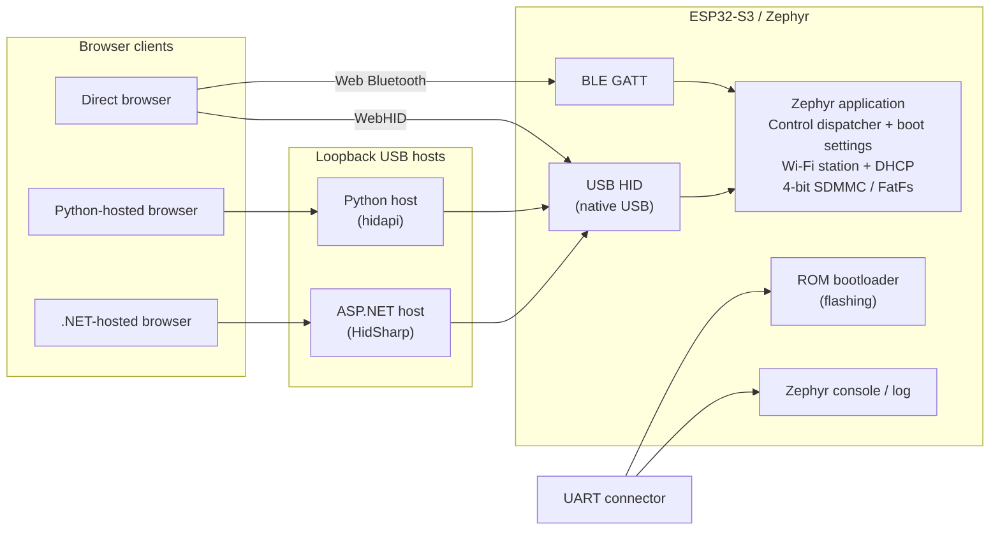

# Architecture

USB HID and BLE share ESPForge report payloads and Control semantics, defined by the
[USB HID](usb-hid.md) and [Bluetooth LE](bluetooth.md) specifications.

## Repository responsibilities

| Layer | Responsibility |
| --- | --- |
| Application lifecycle | Boot order and periodic servicing of control, Wi-Fi, telemetry and USB |
| Board integration | Shared state locking, UID/serial, reset cause, board facts and delayed reboot |
| Control dispatcher | Command validation and execution shared by USB and BLE, with separate result slots |
| Report encoding | Shared identity, configuration, telemetry, storage and wireless payloads |
| Wireless staging and authentication | Expiring credential candidates, BLE session unlock and per-command HMAC proofs |
| USB HID | Native USB management, snapshots and periodic telemetry/storage delivery |
| BLE | GATT service, read snapshots, Control writes and advertising |
| Wi-Fi | Saved-network joins, candidate tests and scans |
| Telemetry and storage | CPU load, temperature and clock; boot-time SD mount and cached card facts |
| Boot settings | One CRC-checked next-boot record for CPU clock, radio switches and credentials ([settings](settings.md)) |
| Board configuration | USB interface, six-signal native SDMMC wiring and temperature sensor |
| Direct dashboard | Independent browser app with WebHID and Web Bluetooth |
| Shared dashboard | Browser UI served by the Python and .NET loopback hosts |
| Python/.NET hosts | USB HID ownership and a local HTTP API for the shared dashboard |

For source layout, dependencies and test commands, see the [firmware development](../development/firmware.md)
and [host development](../development/host-tools.md) guides.

## Lifecycle and failure handling

Boot loads the [settings record](settings.md), applies the CPU clock profile, mounts the SD card once, starts Wi-Fi
(joining the saved network when enabled), starts BLE when enabled with a saved Control key, and then enables USB.
A mount failure is reported in Report 10 and does not stop USB or the radios. No card self-test or file write runs.

USB callbacks run in the USB stack thread and BLE callbacks in the Bluetooth thread. Both call the same control
dispatcher, and every access to settings, staging and wireless state holds one application mutex. Wi-Fi driver
events are queued and applied by the main loop, which also starts connects, disconnects and scans outside the lock.
Reboots are scheduled about one second after the reply so the host can read the result first.

Hosts reject reports outside the wire contracts and never retry a command whose outcome is uncertain; they block further
writes until the user confirms a re-sync. There is no implicit demo fallback.

## Downstream development

Fork this source foundation. Add product work in separate services rather than blocking the main loop or holding the
application lock. Keep GPIO choices in board overlays, keep protocol changes versioned, and update the authoritative
references and all three host paths together. Platform-dependent work must respect the configured single-core
application and existing resource ownership.
