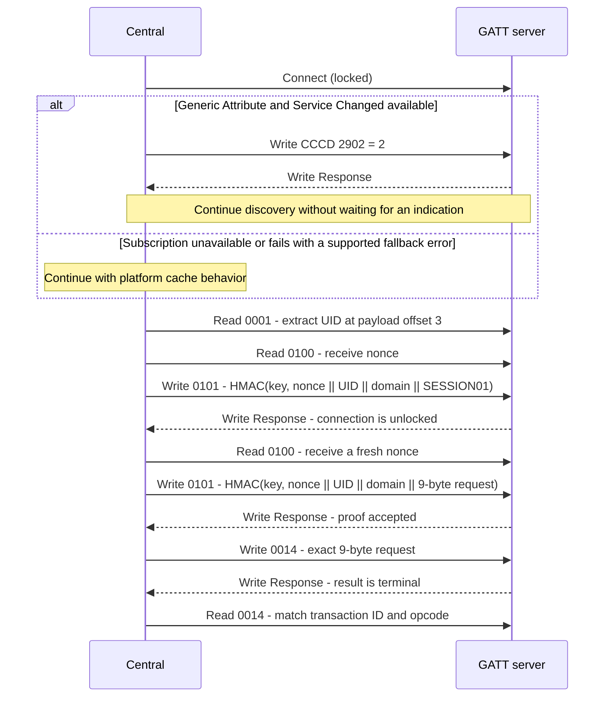

# Bluetooth LE Specification

## Scope and Conventions

This document is the project's Bluetooth LE specification for firmware and clients. It defines startup gating,
advertising, the GATT
layout, session unlock, per-command proofs, the 9-byte control form, and ATT error codes. Breaking wire changes use a
new service UUID; compatible additions MAY retain this UUID. Byte 0 of each report and control payload remains its
payload version. Payload layouts reused from USB and cross-transport command semantics are defined once in the [USB HID
reference](usb-hid.md). Credential persistence is defined in [boot settings](settings.md).
For provisioning and dashboard setup, see the [wireless guide](../guides/wireless.md).

The Direct dashboard implements BLE through Web Bluetooth. Python and .NET dashboards use USB HID only.

In this specification, the **server** is the board acting as a BLE peripheral and GATT server; the **client**
is the central that discovers the service, reads reports and writes control requests. All sizes and offsets are
in bytes. Multibyte report and control integers are little-endian unless stated otherwise. UUIDs are written in
canonical text form; characteristic suffixes are hexadecimal. The nonce and proof are raw byte strings,
not hexadecimal text on the wire.

The key words **MUST**, **MUST NOT**, **SHOULD**, **SHOULD NOT**, and **MAY** are to be interpreted as described
in BCP 14 (RFC 2119, RFC 8174) when, and only when, they appear in all capitals.

Protocol requirements apply to any client or server implementation of this service. References to Zephyr and
the Direct dashboard describe the current implementation, not additional wire fields.
Software tests do not establish hardware qualification; see [Conformance](#conformance).

## Availability

BLE is present only when Report `1` capability bit 7 is set. At boot the firmware loads the saved Control key and
then starts the controller only when the Report `2` Bluetooth switch is on **and** a key is saved. Enabling the
switch without a key logs a warning and leaves the controller off. Saving or clearing the key takes effect at the
next boot. The separate [diagnostic TCP shell](../guides/console.md) is not protected by the BLE Control key.

Report `12` byte 3 (`ble_state`) publishes the controller state:

| Value | State | Meaning |
| ---: | --- | --- |
| `0` | Off | Bluetooth disabled, no key saved, initialization failed, or the controller is not yet working. |
| `1` | Advertising | Controller working and discoverable; no central connected. |
| `2` | Connected | One central is connected. |

A Bluetooth startup failure is logged and can appear as Report `12` detail `1` in the saved-network state when
no Wi-Fi failure detail takes precedence. This detail is not a dedicated BLE error field. Dashboards show `0` with BLE
enabled and a key saved as "starting". State `0` intentionally conflates off, missing key, startup and failure; it
is not an exact reason code, and no separate Starting state is published.

## Advertising

| Item | Value |
| --- | --- |
| Advertising type | Connectable undirected (`ADV_IND`) on all three advertising channels. |
| Interval | 96 units (60 ms) for 30 seconds after startup/disconnect, then 800 units (500 ms). |
| Address | Selected by the controller stack; the current server does not configure rotating-address privacy. |
| Advertising data | Flags `0x06` (LE General Discoverable, BR/EDR not supported); complete list of 128-bit service UUIDs containing the ESPForge service. |
| Scan response | Complete Local Name `ESPForge-<USB serial>`: 16 uppercase hexadecimal digits of the board unique ID, 25 bytes in total. |

The GAP Device Name characteristic returns the same name without unlocking. Advertising starts when the controller
reaches the working state and restarts after every disconnect. Fast discovery is temporary; the slower interval
reduces idle radio use. The firmware does not re-advertise while connected, so it serves one central at a time.
The scan-response name includes the full stable board UID for dashboard selection. Anyone scanning can correlate
observations using that name, regardless of address behavior; this is an accepted
privacy tradeoff for a local development tool.

## Pairing and Bonding

Pairing is not required: [session unlock](#session-unlock) and [command proofs](#command-proofs) authorize
application access. The default firmware does not enable a pairing or bonding workflow, request link encryption,
or persist peer keys. Pairing is not an alternative to the Control key. Bluetooth never writes flash:
the Control key is provisioned through USB and loaded from boot settings.

## GATT Layout

Service UUID: `ef5c0000-7c91-4d70-8b32-6e856443f502`.
Characteristic UUIDs use `ef5cXXXX-7c91-4d70-8b32-6e856443f502`, where `XXXX` is the suffix below.
Breaking wire changes require a new service UUID. Report characteristics use the hexadecimal USB report ID and return that
report's payload **without** the report ID byte. Suffixes `0001`–`00ff` are reserved for report mirrors; `0100`
and above are BLE-specific. Clients MUST reject an unsupported payload version for a known report or control
characteristic. Clients MAY ignore unknown characteristics unless they are required for an operation they use.

The Generic Attribute service includes Service Changed (`0x2A05`) and Database Hash (`0x2B2A`). The database is
static during a boot, but firmware updates can change it. These are standard GATT attributes, separate from the
project's management service.
Cache invalidation behavior is described below. The GAP Appearance is Unknown; Device Information exposes manufacturer `ESPForge` and the firmware
revision.

### Service Changed and Caching

The Bluetooth Core Specification v5.4 (Vol 3, Part G, §2.5.2) limits an unbonded client's attribute cache to the
current connection. The server uses the standard Generic Attribute service and does **not** send a forced
full-range Service Changed indication on every subscription.
Clients MUST honor any Service Changed indication they receive and rediscover the database; they MUST NOT reuse cached handles across
connections. This avoids persisting per-peer cache state.

The Direct client subscribes before ESPForge service discovery when Generic Attribute and Service Changed are
available, then continues without waiting for an indication.
If lookup or subscription fails with `NotAllowedError`, `NotFoundError`, `NotSupportedError` or `SecurityError`, it
warns and continues with the platform's own cache behavior; other errors abort setup.

The UUID table's **Access while locked** column lists permitted operations before session unlock; `Denied` entries
return ATT error `0x80`.

| UUID suffix | Properties | Access while locked | Size | Value |
| --- | --- | --- | ---: | --- |
| GAP `0x2A00` | Read | Read | 25 | Device name, as in the scan response. |
| GAP `0x2A01` | Read | Read | 2 | Appearance `0` (Unknown). |
| GATT `0x2A05` | Indicate | N/A | 4 | Standard Service Changed; no forced per-subscription indication. |
| GATT `0x2902` | Read, Write | Read/write | 2 | Service Changed CCCD; `0` disables, `2` enables indications. |
| GATT `0x2B2A` | Read | Read | 16 | Standard GATT Database Hash. |
| Device Information `0x2A29` | Read | Read | 8 | Manufacturer name `ESPForge`. |
| Device Information `0x2A26` | Read | Read | Variable | Firmware revision, ASCII without NUL. |
| `0001` | Read | Read | 26 | [Report `1`](usb-hid.md#report-id-1-device-identity--capabilities) identity; carries the UID that proofs bind. |
| `0002` | Read | Denied (`0x80`) | 17 | [Report `2`](usb-hid.md#report-id-2-board-configuration) board configuration. |
| `0003` | Read | Denied (`0x80`) | 22 | [Report `3`](usb-hid.md#report-id-3-board-telemetry) telemetry. |
| `000a` | Read | Denied (`0x80`) | 34 | [Report `10`](usb-hid.md#report-id-10-storage-status) storage status. |
| `000b` | Read | Denied (`0x80`) | 32 or 0 | Report `11` benchmark snapshot when capability bit 5 is set; otherwise empty. |
| `000c` | Read | Denied (`0x80`) | 48 | [Report `12`](usb-hid.md#report-id-12-wireless-status) wireless status, including saved SSID and IPv4 address. |
| `000d` | Read | Denied (`0x80`) | 16 | [Report `13`](usb-hid.md#report-id-13-module-memory-inventory) boot-sampled module memory inventory, advertised by identity extension bit 0. |
| `0014` | Read, Write | Denied (`0x80`) | 9 | [Control request/result](#control-characteristic). |
| `0100` | Read | Read | 16 | Fresh challenge nonce; each read replaces the previous one. |
| `0101` | Write Request | Write | 16 | Session or command proof. |

Reports `0002` and `000a` mirror the USB card-detect/MSC flag and live ownership status.
MSC opcode `3` remains USB-only and returns Unsupported/error `4` over BLE. Reboot/save return Busy/detail `1`
while storage is busy or USB-owned; see [USB storage arbitration](usb-hid.md#cross-interface-resource-arbitration).

`0014` is also Write Request only; Write Without Response is not advertised for `0014` or `0101`. Such commands
are rejected by the stack before the application callback, and Write Without Response has no ATT response for a
client to inspect. The Control key is exactly 32 raw bytes (64 hexadecimal digits in the dashboard). Report `1`
UID bytes are at payload offset 3, length 8, in report order. Clients MUST validate the ESPForge identity
(`product_id = 0x0003`, MCU `3`) as described in the
[USB identity contract](usb-hid.md#report-id-1-device-identity--capabilities).
The `0101` proof write is 16 bytes and the `0014`
request is 9 bytes; both fit in the default ATT MTU of 23. Clients MUST use Write Requests, not Write Without
Response or Prepare/Execute (long) writes.

### Read Snapshots

A read at offset `0` builds a new snapshot of the characteristic; ATT Read Blob requests at later offsets return
bytes from that same snapshot, so long reads are consistent without a larger MTU. A blob read whose handle differs
from the last offset-`0` read, or whose offset exceeds the snapshot length, returns ATT error `0x07` (Invalid
Offset); clients MUST restart at offset `0`. Every offset-`0` read of `0003`, `000a` or `000b` advances a BLE
report sequence that is independent of the USB Input-report sequences. The default ATT MTU is 23, so the 26-byte
identity and 48-byte wireless reports require Read Blob requests at that MTU. The negotiated MTU depends on the
server and central. Clients that control MTU negotiation SHOULD
request at least 51; Web Bluetooth does not expose a manual MTU request.

## Session Unlock

Each connection starts locked. Only the GAP name, Appearance, Service Changed CCCD, Database Hash, Device
Information, `0001`, `0100` and `0101` are accessible; other reads and every `0014` write return ATT error `0x80`.
To unlock:

1. Clients MUST read `0001` and keep its 8-byte UID field (raw bytes, in report order).
2. Clients MUST read `0100` to obtain a 16-byte nonce. If the read is empty or has any other size, clients MUST
   NOT write a proof; clients SHOULD retry the challenge read or reconnect. The firmware returns an empty value
   if its random-number request fails.
3. Clients MUST write to `0101` the first 16 bytes of
   `HMAC-SHA256(key, nonce[16] || UID[8] || "PFBLECTL1" || "SESSION01")`.

An accepted proof unlocks the connection until it disconnects. Disconnect clears the unlock, nonce, proof and any
frozen read snapshot. For the `0101` validation order and failure behavior, see [Proof Rules](#proof-rules).

The server MUST obtain the 16-byte challenge from a cryptographically secure random source. The protocol relies
on fresh, unpredictable challenges and does not detect repeated values. Random-source failure produces an empty
challenge read, not a usable nonce; clients MUST validate its length before signing.

## Command Proofs

Opcode `1` has a per-command proof exemption on an unlocked link. It leaves any pending nonce, proof and rate limit
untouched; the session still requires Control-key authentication.
Every other valid-envelope write to `0014`, including an unsupported opcode, consumes a fresh
proof:

1. Clients MUST read `0100` for a new nonce.
2. Clients MUST write to `0101` the first 16 bytes of
   `HMAC-SHA256(key, nonce[16] || UID[8] || "PFBLECTL1" || request[9])`, where `request` is the exact 9-byte
   control request below.
3. Clients MUST write that request to `0014`.
4. A successful ATT Write Response means the command was admitted and its BLE result is already terminal. Clients
   MUST read `0014` and match `transaction_id` and `opcode`.

Proof consumption and retry-delay behavior are defined in [Proof Rules](#proof-rules). The Direct dashboard
disconnects after a rejected session proof.

The board does not enforce transaction-ID uniqueness; clients MUST advance the nonzero ID for every command and
serialize writes. The result is synchronous: `Pending` is not a BLE command outcome.

## Proof Rules

Every successful offset-`0` read of `0100` creates a fresh challenge and invalidates any earlier proof.
Blob reads reuse the snapshot; an empty read after random-source failure supplies no new challenge.
Proof validation depends on the
operation:

- A `0101` Write Request checks length (`0x0D`), retry delay (`0x82`), and key/challenge availability (`0x83`), in
  that order, before staging the 16-byte proof. On a locked connection, the staged proof is immediately checked
  against the session request. Otherwise it is checked against the next valid non-LED `0014` request. The
  missing-key check is defensive: BLE starts only after the control key is loaded, and the key is not cleared while
  BLE is running.
- For a non-LED `0014` write, after the locked-link and envelope checks in [Validation Order](#validation-order),
  authentication checks retry delay (`0x82`), key/challenge availability (`0x83`), proof presence (`0x80`), and
  then the MAC (`0x80`), in that order. Once the retry-delay check passes, if no nonce was read the missing
  challenge returns `0x83`; if a fresh nonce exists but no proof was written, the missing proof returns `0x80`
  without consuming the challenge or starting the delay.

A bad MAC returns `0x80`, consumes the challenge and proof, and starts a two-second delay that persists across
disconnects; a bad session MAC leaves the link locked. The delay applies globally to BLE proof attempts, not just
to one connection. MAC comparison does not exit early. The ASCII domain and request strings have no terminator.

## Worked Proof Vector

These bytes are a public conformance vector, not a production key:

| Input | Hex |
| --- | --- |
| Key | `000102030405060708090a0b0c0d0e0f101112131415161718191a1b1c1d1e1f` |
| Nonce | `000102030405060708090a0b0c0d0e0f` |
| UID | `0001020304050607` |
| Session request | ASCII `SESSION01` |
| Session proof | `7c583e03087e013dc444f219fa69cfe4` |
| Command request | `010702010000000000` (confirmed reboot) |
| Command proof | `c090cfe4b5d641b4dd4f8d710c7dad6d` |

Proofs are the first 16 bytes of HMAC-SHA256 as defined above. Firmware authentication and Direct transport
tests verify this vector.

## Exchange Sequence

## Control Characteristic

Writes to `0014` use a 9-byte form, not a truncated USB Feature `20` report. Status, error and detail values match
[Feature `20`](usb-hid.md#report-id-20-control-command--result).

### Request

| Offset | Size | Field | Meaning |
| -----: | ---: | ----- | ------- |
| 0 | 1 | `version` | `1`. |
| 1 | 1 | `transaction_id` | Nonzero; independent of the USB sequence. |
| 2 | 1 | `opcode` | `2` confirmed reboot or `5` save settings and reboot; `1` is recognized but unsupported. |
| 3 | 1 | `flags` | Opcode `2` requires confirmation bit 0; opcode `5` requires zero (no forced save or wireless commit). |
| 4 | 5 | `arguments` | Opcode arguments; unused bytes zero. |

Opcode `1` uses argument byte 0 as an RGB mask `0`-`7`, with flags and other arguments zero, as specified in
[USB HID](usb-hid.md). Completed means queued transmission, not physical verification.
Opcode `2` has zero arguments and requires
flag bit 0. For opcode `5`, bytes 4-5 are the system clock in MHz (little-endian): `0` (build default), `80`, `160`
or `240`. Byte 6 MUST be `0` (Standard SD-card profile), byte 7 is the switch mask (bit 0 Wi-Fi, bit 1 BLE),
and byte 8 MUST be zero. All opcode `5` flags MUST be zero.

A BLE save MUST preserve the saved radio mask. A different mask, an unsupported clock, a nonzero SD-card profile,
or switch bit 2 (TCP CLI) returns Invalid/error `3` with detail `0`. BLE cannot stage or commit credentials.

### Result

| Offset | Size | Field | Meaning |
| -----: | ---: | ----- | ------- |
| 0 | 1 | `version` | `1`. |
| 1 | 1 | `transaction_id` | ID of the latest BLE result; `0` before any request. |
| 2 | 1 | `opcode` | Opcode of that result; `0` before any request. |
| 3 | 1 | `status` | Feature `20` status. |
| 4 | 1 | `error_reason` | Feature `20` error. |
| 5 | 4 | `data` | Invalid, Busy or Failed: byte 0 is the detail, bytes 1-3 zero. Successful opcode `5`: clock MHz (little-endian), SD-card profile, saved switch mask. Otherwise zero. |

The wireless commit mask is USB-only and is never present in a BLE result. The BLE result slot is one global
in-memory slot shared across connections: a new BLE command replaces it, disconnect does not clear it, and reset
does. It has no client attribution and transaction IDs are not globally unique, so a reconnect can inspect a result
only if the board has not reset and no later admitted BLE command has replaced it; a matching ID and opcode do not
prove which connection produced it.

### Validation Order

1. Locked link: ATT error `0x80`. The envelope is not checked.
2. Invalid envelope (length other than 9, version other than `1`, or transaction ID `0`): ATT error `0x81`. The
   result slot, nonce and proof are unchanged.
3. Non-LED requests follow the proof lifecycle and failure mapping in [Proof Rules](#proof-rules). LED requests
   skip authentication.
4. Opcodes `3`, `4` and `6`-`13` (assigned but USB-only): Unsupported/error `4` in the result slot.
   Unassigned opcodes: Unsupported/error `7`.
5. Opcodes `1`, `2` and `5` follow the shared [error precedence](usb-hid.md#get-result) for their arguments and
   state, with ESPForge's unsupported-feature restrictions.
   Valid save arguments are checked before USB staging conflicts: opcode `5` returns Busy/error `5` with
   detail `28` while unexpired USB-staged wireless values exist. Opcode `2` also returns Busy/error `5`,
   detail `28` in that case, after validating its arguments and confirmation flag.
   There is no forced USB save implementation.

USB and BLE keep separate result slots and transaction sequences; a request on one never replaces the other's result,
and BLE authentication state is separate from USB staging. ESPForge has no TCP CLI proofs.
See [Feature `20` result semantics](usb-hid.md#get-result).

### Uncertain Outcomes

Clients MUST serialize control requests. A timeout before the `0014` Write Response leaves admission uncertain; a
disconnect after a successful response but before the result read can hide the terminal result. Clients MUST
reconnect and inspect the result or resulting device state; clients MUST NOT replay a state-changing request with
an uncertain outcome. The result-slot lifetime and limitations are described in [Result](#result).
Clients MUST abandon the transaction and reconnect after an ATT transaction timeout.

Accepted reboot and save-and-reboot commands are followed by a reset after a 1000 ms
grace period, intended to allow the result read. This is not a guarantee that a slow
connection can finish reading before reset.

## ATT Errors

| Code | Name | Cause |
| --- | --- | --- |
| `0x80` | Application: control rejected | Locked read/write, or missing or rejected proof. |
| `0x81` | Application: invalid envelope | `0014` write with wrong length, version or transaction ID on an unlocked link. |
| `0x82` | Application: rate limited | Proof operation attempted during the two-second delay after a rejected proof. |
| `0x83` | Application: challenge unavailable | Missing key or no fresh nonce for the requested proof. |
| `0x02` | Read Not Permitted | Stack rejects a read of write-only `0101`. |
| `0x03` | Write Not Permitted | Write to a read-only characteristic. |
| `0x06` | Request Not Supported | Prepared (long), offset or Write Without Response writes rejected by the application callbacks. Write Without Response has no ATT response. |
| `0x07` | Invalid Offset | Read Blob uses a different handle than the active snapshot, or an offset exceeds the snapshot length. |
| `0x0D` | Invalid Attribute Value Length | `0101` write that is not 16 bytes. |

These ATT errors apply to requests that receive an ATT response. Standard GAP/GATT attributes, including CCCD
validation and caching, are handled by the Bluetooth stack and can return stack-defined ATT errors. The server's application
authorization callbacks use `0x80`, not Insufficient Authentication (`0x05`), so a rejected Control-key proof is
not an instruction to pair through the operating system.

## Security Properties

| Threat | Existing controls | Residual risk |
| --- | --- | --- |
| Passive traffic observation | The Control key never crosses the link. | The default link is not encrypted; observers within radio range can read unlocked status (including SSID and IPv4 address) and command traffic. |
| Cross-session result disclosure | Session unlock is required to read `0014`. The result slot is shared across connections and survives disconnects. | A later authorized central can read the previous central's last admitted command result. Successful opcode `5` results include the saved clock, SD-card profile and switch mask; transaction IDs do not identify the originating connection. |
| Proof replay or alteration | One-use challenges, a cryptographically secure random source and HMAC request binding prevent reuse of a proof for a different request. | Repeated or compromised nonces weaken replay protection; the application does not detect repeats. See [Session Unlock](#session-unlock). |
| Cross-board or cross-protocol proof reuse | The proof binds the board UID and uses the fixed `PFBLECTL1` domain. | There is no board-authentication proof; the client SHOULD verify the selected UID before trusting status. The domain is not a unique project identity; another protocol using the same key, UID and proof inputs is not isolated by it. |
| Active attacker on a live link | A command proof is bound to one exact request and is accepted once. | An attacker able to inject traffic into an unlocked connection can race an observed proof and its exact bound command, or control/proxy the live link. Proofs do not provide link security. |
| Session left unattended | Authorization is cleared on disconnect. | There is no idle relock; clients SHOULD disconnect when finished. |
| Device tracking | None. | The stable advertised name permits tracking; rotating-address privacy is not configured by the application. |
| Denial of service | One central is served at a time; disconnecting frees the slot. | A central can hold that connection, and radio jamming can prevent communication. |
| Online brute force | A global two-second retry delay applies after a rejected MAC and persists across reconnects. | At continuous uptime, this permits about 43,200 failed guesses per day. If the key is uniformly random and each guess is independent against an ideal 128-bit HMAC tag, the success probability is about 1.3×10^-34 per day. The firmware accepts any 32-byte key; key quality is the user's responsibility. A reboot resets the volatile delay. |

These security properties and residual risks are accepted tradeoffs for a local development tool.

## Operational Notes

Connection interval and supervision timeout are managed by the server and central stacks; this specification does not
promise a disconnect-detection deadline. Application notifications are intentionally omitted: the
Direct dashboard polls reports every 250 ms. Standard Service Changed indications are managed by the Bluetooth stack; the Direct subscription is ephemeral
and used only for cache invalidation. The browser chooses MTU negotiation for Web Bluetooth clients.

BLE cannot stage credentials, test or scan Wi-Fi, produce TCP CLI proofs, run benchmarks, change radio switches,
force a save, or change USB storage ownership.

## Conformance

| Test ID | Requirement | Verification |
| --- | --- | --- |
| BT-001 | Session unlock, one-use proofs and reconnect-persistent retry delay. | Firmware authentication tests |
| BT-002 | HMAC-SHA256 BLE proof vectors, including the worked vector above. | Firmware authentication and Direct transport tests |
| BT-003 | Service Changed subscription/fallback, UUID lookup, proof signing and the restricted 9-byte command envelope. | Direct transport tests |
| BT-004 | BLE opcode restrictions, save validation, result isolation and USB staging conflicts. | Firmware control tests |

These tests use portable modules and simulated browser transports. They do not qualify the Zephyr GATT callbacks,
controller startup, over-the-air advertising, negotiated MTU or live cache behavior; those require ESP32-S3 hardware.
See the [qualification gaps](../validation/qualification-gaps.md). Test commands are maintained in the
[firmware](../development/firmware.md) and [host development](../development/host-tools.md) guides.

## Implementation

The current firmware uses Zephyr's Bluetooth host with the ESP32-S3 controller.
`CONFIG_BT_GATT_SERVICE_CHANGED` and `CONFIG_BT_GATT_CACHING` enable the standard caching attributes.
Challenges use the ESP32-S3 entropy source through Zephyr's cryptographically secure random API.
Accepted reboot commands use a 1000 ms grace period.

Bluetooth callbacks run in the Zephyr Bluetooth thread. They hold the application mutex while accessing
authentication, read snapshots and the shared control dispatcher. Advertising slowdown uses delayed Zephyr work;
connectable advertising restarts when the disconnected connection object is recycled.
Python and .NET hosts do not use BLE. See [architecture](architecture.md#lifecycle-and-failure-handling)
for cross-transport locking and lifecycle rules.

## Specification History

The initial wire design was derived from the
[PicoForge Bluetooth LE specification](https://github.com/djwinter29-oss/PicoForge/blob/5e615725b22714963c2d16ed56215042e1411553/docs/reference/bluetooth.md)
at commit `5e615725b227`. This document defines the current project contract; the upstream document is historical
context, not an additional source of requirements. The `PFBLECTL1` proof domain remains unchanged on the wire.
