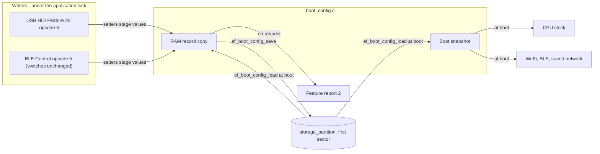
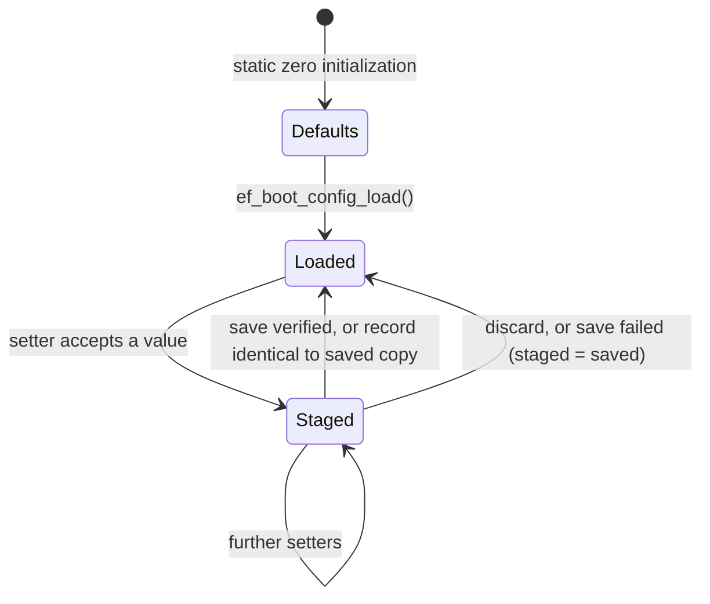
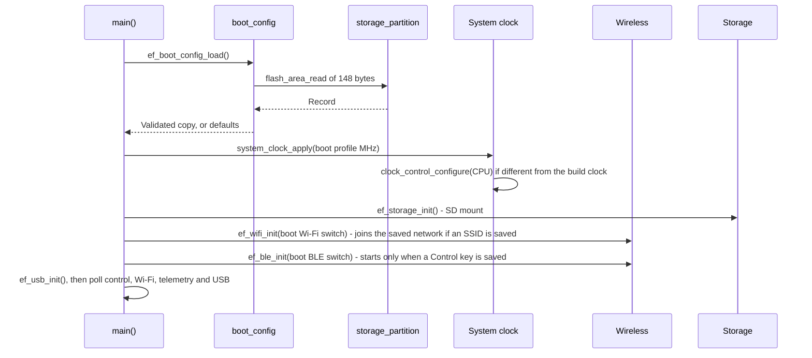
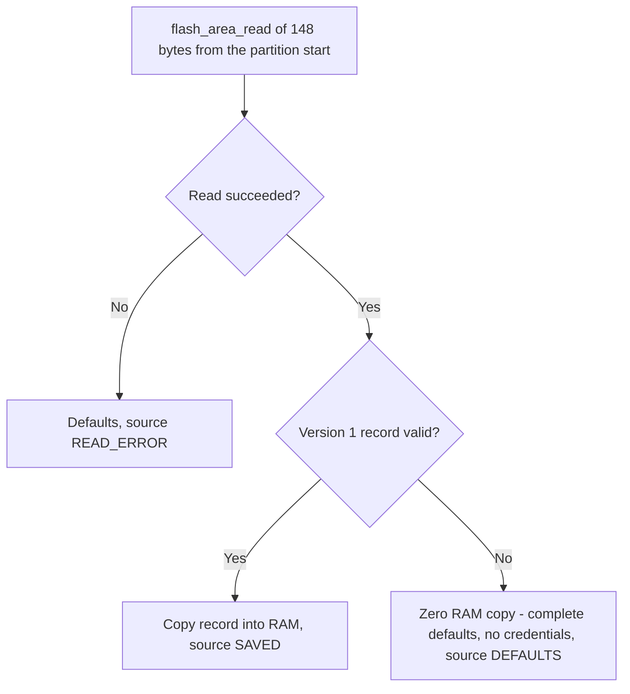
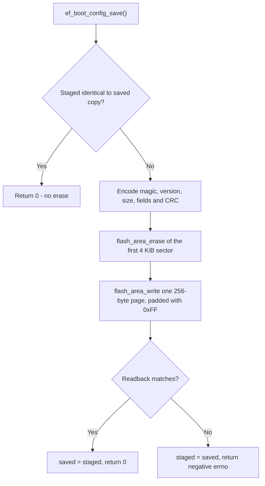
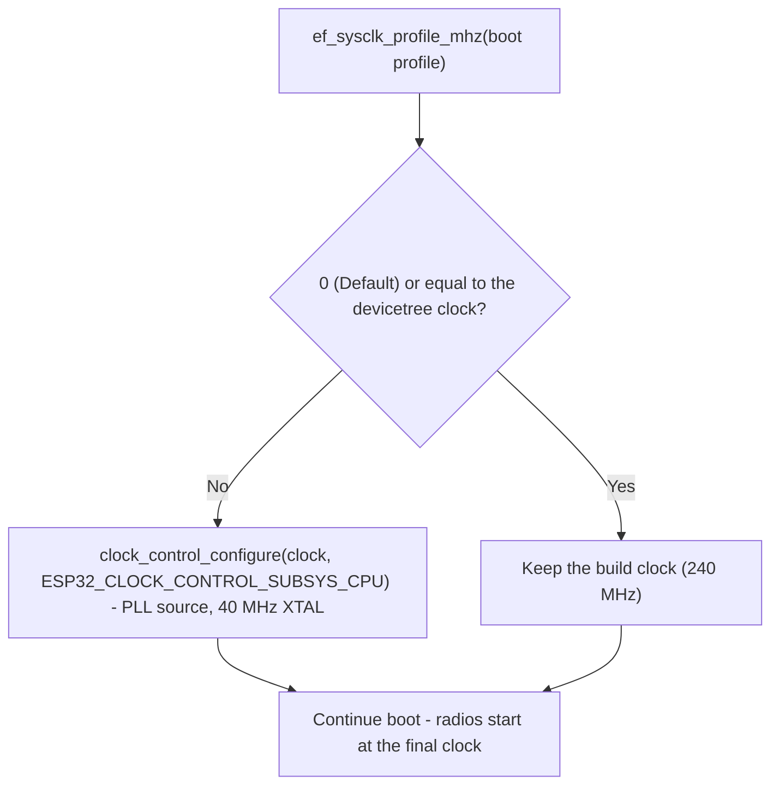

# Boot Settings Design

> **Adapted from PicoForge.** This design follows PicoForge's
> [Boot Settings Design](https://github.com/djwinter29-oss/PicoForge/blob/5e615725b22714963c2d16ed56215042e1411553/docs/reference/settings.md)
> (commit `5e61572`): one verified record, a RAM copy, transactional staging, next-boot application and a single
> writer. Platform details are ESP32-S3/Zephyr specific. The [implementation status](#implementation-status) section
> lists what the current firmware applies and what is still a target.

ESPForge keeps a small set of **next-boot settings** in one flash record: the CPU clock profile, the Wi-Fi and BLE
switches, and the private wireless credentials. They are changed at runtime, saved as one verified record, and take
effect only at the next boot. This document owns the record format, the load/stage/save lifecycle, flash safety and
how each setting is applied. The wire encoding is HID Feature report `2` and Feature report `20` opcode `5` in the
[USB HID reference](usb-hid.md), adapted by the [ESPForge implementation reference](espforge-implementation.md). Radio behaviour is in the
[wireless guide](../guides/wireless.md).

| Setting | Values | Default | Applied by |
| --- | --- | --- | --- |
| CPU clock (`ef_sysclk_profile_t`) | Default (devicetree build clock, 240 MHz), 80, 160 or 240 MHz | Default | `system_clock_apply()` at the start of `main()` |
| Wi-Fi / Bluetooth switches | Enabled or disabled | Enabled | `ef_wifi_init()` / `ef_ble_init()` at boot |
| Wi-Fi SSID, passphrase and auth state | See [record format](#record-format) | None | Saved-network connect at boot |
| Control key | 32 raw bytes, see [record format](#record-format) | None | [BLE control](bluetooth.md) authentication; BLE does not start without a key |

Wi-Fi and BLE stay **enabled by default**: an erased, missing or invalid record enables both radios.

## Architecture

All settings pass through one RAM copy owned by [boot_config.c](../../firmware/src/platform/boot_config.c). Writers only
stage values in RAM; one save call commits the complete record to flash. Consumers read the boot snapshot, so a saved
change never alters running hardware.



The design rules are:

- **One record, one CRC.** Clock profile, switches and credentials commit together or not at all.
- **Next boot only.** The clock is set and the radios start once at boot, so setters change only RAM and saved
  values apply after reboot. Feature report `2` reports the saved values, not the ones running now.
- **One lock.** `ef_boot_config_load()` runs first in `main()`, before USB and BLE start. Afterwards every read
  and save runs inside the shared control dispatcher under the application mutex (`ef_lock()`), whether the request
  arrived over USB HID or BLE. This is not a general multi-thread settings API.
- **Boot never depends on flash.** Any missing, unreadable or invalid record loads complete defaults.
- **No generic store.** The fixed record is read directly and written as one padded page through the
  `flash_area` API. Zephyr's settings/NVS subsystems are not used. Record validation is private to `boot_config.c`
  and flash access is private to [boot_flash.c](../../firmware/src/platform/boot_flash.c).

## RAM Copy Lifecycle

The module holds three copies: **staged** (what setters change), **saved** (the last record loaded or confirmed) and
**boot** (what the running firmware applied). Unlike PicoForge, there is no lazy first-use loading: `main()` loads
explicitly before any thread can read settings, so there is no pending-load state and setters never fail for context
reasons.



A setter that rejects an out-of-range value returns `false` without changing the copy.

### Transactional staging

Each writer stages every requested value and then saves once. Any outcome other than a verified save discards the
staged values, so no partial request survives:

- **Opcode `5`:** stages the clock and radio switches and, when the commit flag is set, the wireless values staged
  by opcodes `6`-`8` (SSID, passphrase with auth state `0`, try WPA2, and Control key). Anything but a verified save
  calls `ef_boot_config_discard()`. See [Host Dashboard Settings](#host-dashboard-settings).
- Opcodes `6`-`8` hold their values in the control module's stage, not in `boot_config.c`, until opcode `5`
  commits them. Opcode `9` tests staged credentials without saving them.

A failed save does not prove that flash is unchanged: an erase can complete before programming fails. The staged
copy then returns to the last confirmed values, while the next boot loads whatever flash actually contains
(complete defaults if the record is damaged). Failed commands never reboot automatically.

## Boot Sequence



The load runs in `main()` before USB and the BLE stack start, and before any other thread can read
settings. Every later consumer reads the same copies.

### Loading and validation



A record is valid only if all of these hold: magic `EFCF`, version `1`, size `148`, matching CRC-32, clock profile
`0`–`3`, a zero byte 9, no unknown service bits, Wi-Fi auth state `0`–`3`, SSID length at most 32 with zero padding,
an empty or 8–63 byte NUL-terminated passphrase with zero padding, zero reserved bits, and a zero key whenever the
key-present flag is clear. Fields are never applied partially. Loading never writes flash. An erased partition
(`0xFF`) loads defaults. `ef_boot_config_source()` reports which case occurred.

## Saving

`ef_boot_config_save()` is the only settings writer in ESPForge.



The Zephyr ESP32 flash driver suspends the cache and serializes SPI-flash access while erasing and programming, so
other threads and radio interrupts may be delayed briefly. Saves are rare user actions and happen only in the main
thread. Stack buffers holding the encoded record are cleared after use.

## Record Format

Little-endian, 148 bytes, padded with `0xFF` to one 256-byte page at the start of the settings sector. The layout
deliberately keeps PicoForge's version 2 offsets so host code and tests can be shared. Only the magic, version and
the meaning of the profile bytes differ.

| Offset | Size | Content |
| --- | --- | --- |
| 0 | 4 | magic `EFCF` |
| 4 | 2 | format version (`1`) |
| 6 | 2 | record size (`148`) |
| 8 | 1 | CPU clock profile (`0` Default, `1` 80 MHz, `2` 160 MHz, `3` 240 MHz) |
| 9 | 1 | Reserved, zero (PicoForge's SD-card speed profile; see [SD-Card Speed](#sd-card-speed)) |
| 10 | 1 | Disabled services: bit 0 Wi-Fi, bit 1 Bluetooth; other bits invalid |
| 11 | 1 | Wi-Fi authentication state (`0` try WPA2, `1` try WPA3-SAE, `2` WPA2, `3` WPA3-SAE) |
| 12 | 1 | Wi-Fi SSID length (`0`–`32`) |
| 13 | 32 | Raw Wi-Fi SSID bytes; unused bytes zero |
| 45 | 64 | Wi-Fi passphrase, NUL-terminated; empty or 8–63 bytes; unused bytes zero |
| 109 | 32 | Raw Control key; presence is recorded separately |
| 141 | 1 | Credential flags: bit 0 Control key present; other bits zero |
| 142 | 2 | Reserved, zero |
| 144 | 4 | CRC-32 (IEEE, reflected) of bytes 0–143 |

The record stores profiles, not MHz; host protocols carry MHz. Service bits are stored as *disabled* flags so an
erased or zeroed record enables every radio. PicoForge's TCP CLI bit (bit 2) is invalid here because ESPForge has no
TCP CLI. The passphrase accepts any non-NUL bytes, matching the existing host UTF-8 rules. PicoForge requires
printable ASCII. Any 32-byte key value is supported, including all zero; clearing a key removes its presence flag.

Flash is **unencrypted**. Physical, UART-download or JTAG access can recover credentials, and erasing settings
clears them. ESP32-S3 flash encryption is not enabled by this starter.

**Power loss.** There is a single copy. A power loss during erase or program leaves a record that fails validation
and loads as complete defaults with no credentials: both radios are enabled again and Wi-Fi waits to be
provisioned.

ponytail: one sector and no wear levelling. This is acceptable because saves are infrequent user actions. If old
values must survive a power loss, or writes become frequent, upgrade to a dual-sector journal or Zephyr ZMS/NVS.

## Flash Reservation

The record lives at offset `0` of the devicetree `storage_partition`. On the `esp32s3_devkitc/esp32s3/procpu`
target, the [board overlay](../../firmware/boards/esp32s3_devkitc.overlay) selects Zephyr's 16 MB
`partitions_0x0_amp_16M.dtsi` table for the N16R8 module: `0xFB0000`, 192 KiB. Only the first
4 KiB sector is used. The offset is taken from devicetree (`FIXED_PARTITION_ID(storage_partition)`), not
hard-coded in C.

- The build uses ESP simple boot, so the image is flashed at `CONFIG_FLASH_LOAD_OFFSET` (`0x0`).
  [check_firmware_config.py](../../tools/check_firmware_config.py) fails when `zephyr.bin` would reach
  `storage_partition`. CI runs it after every firmware build.
- [flash.sh](../../tools/firmware/flash.sh) passes `--no-erase`, so normal uploads keep saved settings. A full-chip
  erase, or a different partition table, clears them.
- To reset settings manually, erase only the settings sector from an initialized workspace:
  `python -m esptool --chip esp32s3 --port PORT erase_region 0xFB0000 0x1000`. The next boot loads defaults.

A board or partition table without `storage_partition` does not build.

## System Clock

The saved profile is applied in `main()` by `system_clock_apply()`
([system_clock.c](../../firmware/src/platform/system_clock.c)), after the settings load and before the radios, SD mount and
USB start. It never writes flash.



- Kernel ticks come from the ESP32-S3 SYSTIMER (16 MHz from the 40 MHz crystal), not the CPU clock, so Zephyr
  timeouts and uptime are preserved.
- Wi-Fi and BLE start after the change; Espressif requires at least 80 MHz for the radios, and every profile meets
  that.
- An apply error is ignored and the build clock remains. Telemetry report `3` carries the running CPU clock.

`cpu0 clock-frequency` in devicetree describes the **build** clock, not the runtime speed. Select another clock
through the saved profile, not a devicetree override.

**Clock safety.** All three profiles are within the ESP32-S3 specification. Lower clocks reduce throughput and can
increase radio latency; none of them is hardware-qualified yet.

## SD-Card Speed

PicoForge stores a runtime SD speed profile. ESPForge does not. The SD card is attached through Zephyr's
`zephyr,sdhc-spi-slot` driver, whose clock ceiling is the devicetree `spi-max-frequency` (10 MHz in
[esp32s3_devkitc.overlay](../../firmware/boards/esp32s3_devkitc.overlay)). The driver has no runtime API to change
it. Record byte 9 is therefore reserved as zero, which keeps PicoForge's offsets, and the speed is changed in the
overlay. See the [SD storage contract](sdcard.md).

## Using the API

```c
#include "boot_config.h"

ef_boot_config_load();                                         /* once, first in main() */
ef_sysclk_profile_t clk = ef_boot_config_boot_sysclk();        /* profile applied at this boot */
uint8_t radios = ef_boot_config_boot_radios();                 /* EF_WIRELESS_* started at this boot */
ef_boot_config_set_sysclk(EF_SYSCLK_160MHZ);                   /* RAM copy only; false for unknown profiles */
ef_boot_config_set_radios(EF_WIRELESS_WIFI);                   /* disable BLE at the next boot */
if (ef_boot_config_save() != 0) { /* staged values already discarded */ }
bool reboot = ef_boot_config_restart_required();               /* saved differs from this boot */
```

The header also exposes SSID (string and opaque bytes), passphrase, auth-state and Control-key accessors. Unprefixed
getters return the staged copy, `boot_` getters return what the running firmware applied, and
`ef_boot_config_wireless_restart_required()` ignores clock-only changes. The inline `ef_sysclk_profile_mhz()` (`0`
for Default) and `ef_sysclk_profile_from_mhz()` conversions accept arbitrary values for protocol validation.

## Host Dashboard Settings

HID Feature report `2` reads the saved settings. Feature report `20`, opcode `5`, saves them and reboots. The
profile payload keeps PicoForge's layout: a two-byte little-endian `system_clock_mhz` (`0`, `80`, `160` or `240`
here), a one-byte `sdcard_profile` that must be `0`, and one-byte service switches (bit 0 Wi-Fi, bit 1 BLE; bit 2
must be `0`). The Python, .NET and Direct dashboards show the same **Save&Reboot** controls as PicoForge, without TCP
CLI and SD speed selectors:

- **Save&Reboot** sends opcode `5`. Firmware reboots about one second after a verified save; failed or rejected
  saves do not reboot. Reconnection refreshes Feature `2`.
- **Wi-Fi** and **Bluetooth** are next-boot controls, enabled by default. Over BLE, opcode `5` must keep the current
  switches, as in PicoForge.
- **CPU clock** offers Default, 80, 160 and 240 MHz.

### Forced Save and Reboot

PicoForge's forced save exists because the computer can own its SD card as a USB drive. ESPForge has no USB mass
storage. Every save is therefore a normal save, forced saving (capability bit 6) is not advertised, and the forced
flag is Unsupported.

## Implementation Status

| Item | Status |
| --- | --- |
| Record format, CRC, validation, staging, discard, restart-required | Implemented in `boot_config.c`; native tests |
| `storage_partition` read, erase, program and readback | Implemented in `boot_flash.c`; builds, pending hardware |
| CPU clock profile applied at boot | Implemented in `system_clock.c`; builds, pending hardware |
| Radio switches applied at boot | Implemented; pending hardware |
| Wi-Fi credentials staged by opcodes `6`/`7`, committed by opcode `5`, joined at boot | Implemented in `control.c` and `wifi.c`; native tests for the control path, pending hardware |
| WPA3-SAE probing and confirmed auth state | Field stored; firmware connects with WPA2-PSK |
| Control key staged by opcode `8`; BLE authentication | Implemented in `control.c`, `wireless_auth.c` and `ble.c`; pending hardware |
| Host settings editor (HID Feature `2` / `20` opcode `5`) | Implemented in the firmware and all three dashboards; pending hardware |

## Tests

Host tests run with `bundle exec ceedling test:all`. The focused check is
`bundle exec ceedling test:test_boot_config`. [test_boot_config.c](../../firmware/tests/platform/test_boot_config.c)
replaces `boot_flash.c` with an in-memory fake. Its tests cover:

- defaults from erased flash and from read errors;
- the CRC-32 check value and the documented byte offsets;
- round trips, including opaque SSIDs and all-zero keys;
- next-boot snapshots and restart detection;
- unchanged-save detection and failed-save discard;
- setter limits, and every malformed field with a valid CRC.

[test_control.c](../../firmware/tests/app/control/test_control.c) covers opcode `5`, the commit flag and the radio switches. Flash
programming, clock changes and saved-network reconnects need hardware and are listed in the
[qualification gaps](../validation/qualification-gaps.md).
