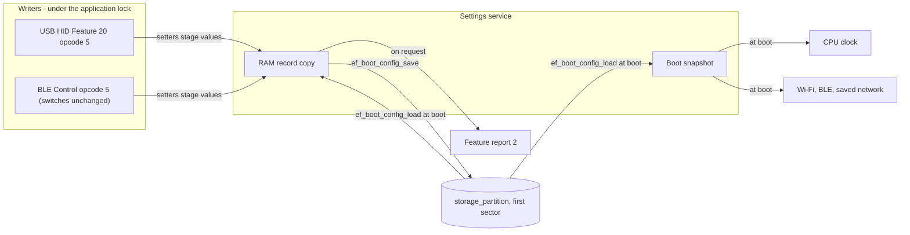
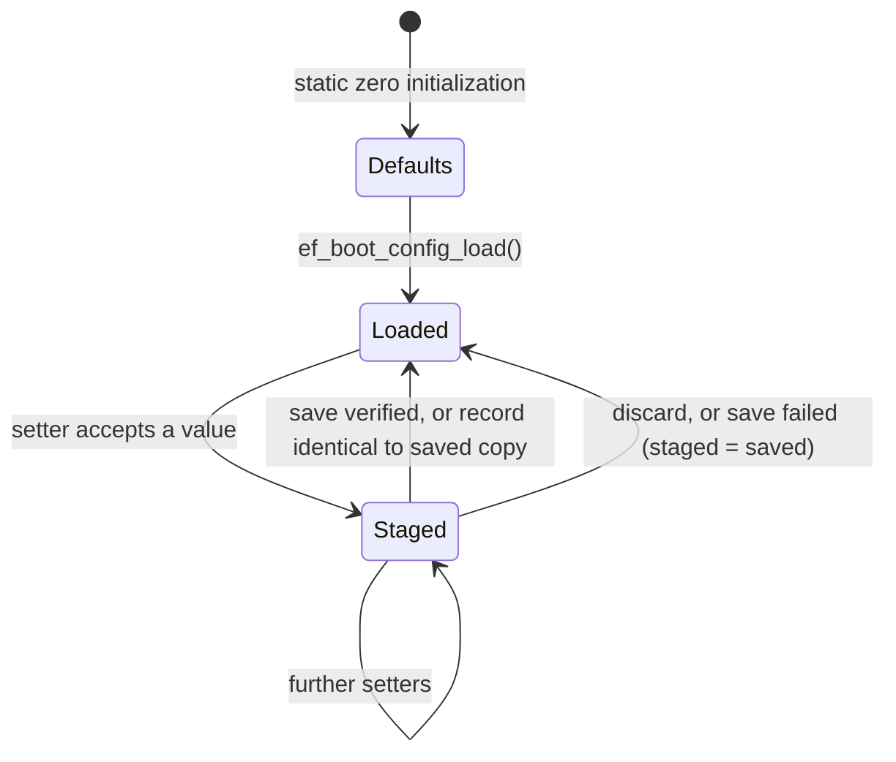
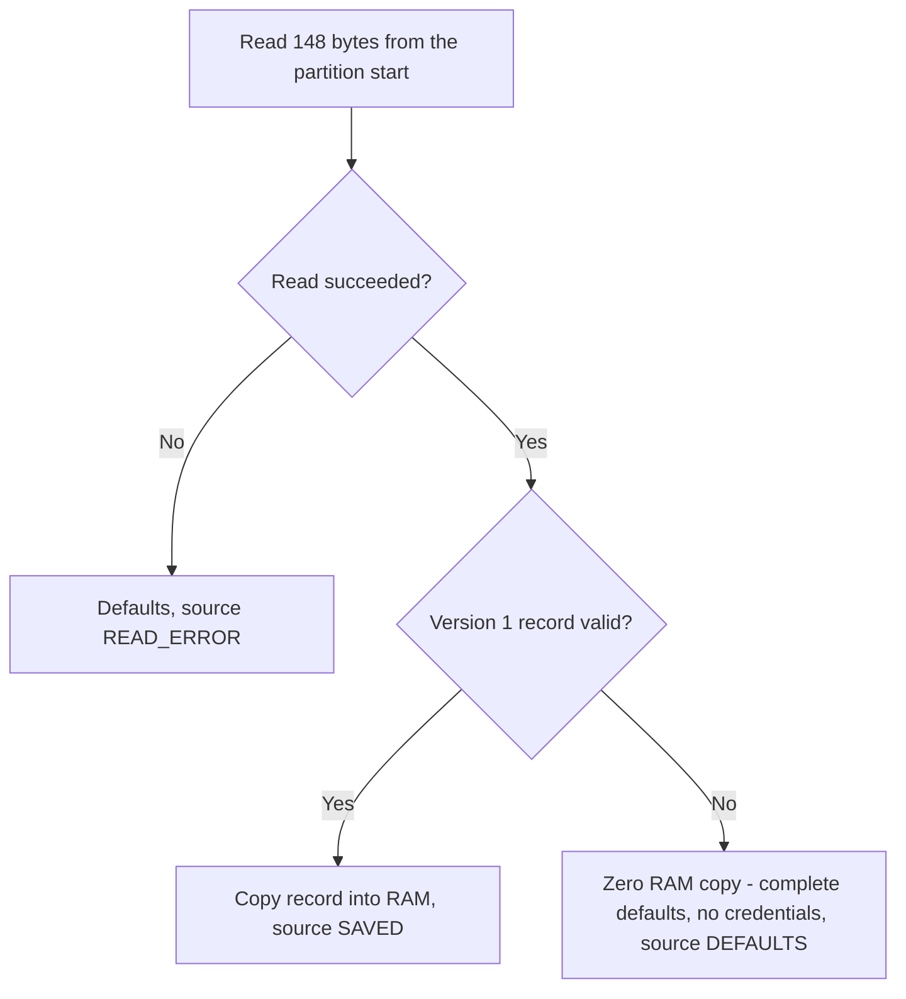
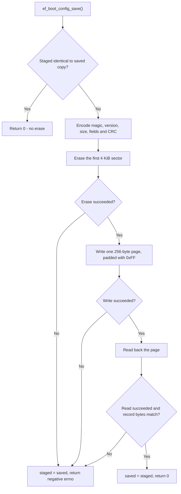
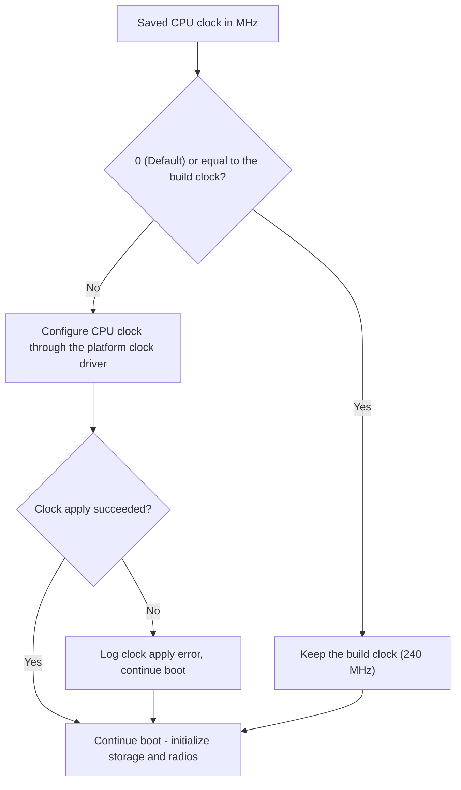

# Boot Settings Specification

## Scope and Conventions

This document is the project's boot-settings specification. It defines the persistent record, defaults,
validation, load/stage/save lifecycle, next-boot application and flash-safety limits.
The device keeps a small set of **next-boot settings** in one flash record: the CPU clock profile, the Wi-Fi and BLE
switches, and the private wireless credentials. They are changed at runtime, saved as one verified record, and take
effect only at the next boot. This document owns the record format, the load/stage/save lifecycle, flash safety and
how each setting is applied. The wire encoding is HID Feature report `2` and Feature report `20` opcode `5` in the
[USB HID specification](usb-hid.md) and the [Bluetooth LE specification](bluetooth.md).
The [implementation reference](espforge-implementation.md) records board/platform details, not a separate protocol.
Radio behaviour is in the
[wireless guide](../guides/wireless.md).

All record offsets and sizes are in bytes. Multibyte integers are little-endian.
SSID and Control-key fields are raw bytes; the passphrase is a NUL-terminated byte string.
The persistent record version is independent of HID/BLE payload versions and firmware semantic version.

The key words **MUST**, **MUST NOT**, **SHOULD**, **SHOULD NOT**, and **MAY** are to be interpreted as described
in BCP 14 (RFC 2119, RFC 8174) when, and only when, they appear in all capitals.
API names describe the current implementation; internal source layout is not part of this contract.

| Setting | Values | Default | Applied when |
| --- | --- | --- | --- |
| CPU clock (`ef_sysclk_profile_t`) | Default (devicetree build clock, 240 MHz), 80, 160 or 240 MHz | Default | Early boot, before storage and radios |
| Wi-Fi / Bluetooth switches | Enabled or disabled | Enabled | Radio initialization at boot |
| Wi-Fi SSID, passphrase and auth state | See [record format](#record-format) | None | Saved-network connect at boot |
| Control key | 32 raw bytes, see [record format](#record-format) | None | [BLE control](bluetooth.md) authentication; BLE does not start without a key |

Wi-Fi and BLE stay **enabled by default**: an erased, missing or invalid record enables both radios.

## Architecture

All settings pass through the settings service's RAM state. Writers only
stage values in RAM; one save call commits the complete record to flash. Boot initialization uses the boot
snapshot. Saving does not reconfigure the running hardware; host save commands schedule a subsequent reboot.



The design rules are:

- **One record, one CRC.** Clock profile, switches and credentials are validated as one unit; no partial record
  is applied. This is not a power-loss-atomic transaction.
- **Next boot only.** The clock is set and the radios start once at boot, so setters change only RAM and saved
  values apply after reboot. Feature report `2` reports the saved values, not the ones running now.
- **One lock.** `ef_boot_config_load()` runs during early boot, before USB and BLE start. Afterwards every read
  and save MUST be serialized under the application mutex (`ef_lock()`), whether the request
  arrived over USB HID or BLE. This is not a general thread-safe settings API.
- **Boot never depends on flash.** Any missing, unreadable or invalid record loads complete defaults.
- **No generic store.** The fixed record is read directly and written as one padded page through the
  flash API. Zephyr's settings/NVS subsystems are not used. Record validation and flash access are internal
  responsibilities of the settings service.

## RAM Copy Lifecycle

The module holds three copies: **staged** (what setters change), **saved** (the last record loaded or confirmed) and
**boot** (what was loaded for this boot). The boot snapshot is intended policy, not proof that clock or radio
initialization succeeded. There is no lazy first-use loading: boot loads explicitly before settings consumers
start. Later callers MUST hold the application lock.



A setter that rejects an out-of-range value returns `false` without changing the copy.

### Transactional staging

Each writer MUST validate and stage every requested value, then save once. Rejected staging MUST be discarded;
a failed save restores the last confirmed RAM values:

- **Opcode `5`:** stages the clock and radio switches and, when the commit flag is set, the wireless values staged
  by opcodes `6`-`8` (SSID, passphrase with auth state `0`, try WPA2, and Control key).
  Flash-save failure calls `ef_boot_config_discard()`. See [Host Dashboard Settings](#host-dashboard-settings).
- Opcodes `6`-`8` hold separate wireless candidates, not settings-service state, until opcode `5`
  commits them. Opcode `9` tests staged credentials without saving them.

A failed save does not prove that flash is unchanged: an erase can complete before programming fails. The staged
copy then returns to the last confirmed values, while the next boot loads whatever flash actually contains
(complete defaults if the record is damaged). If flash verification succeeds but scheduling reboot fails,
opcode `5` reports Failed even though settings were persisted. Hosts MUST reconcile saved state rather than
assuming every failed command left flash unchanged. Failed commands do not schedule an automatic retry or reboot.

## Boot Sequence

```mermaid
sequenceDiagram
    participant M as Boot lifecycle
    participant B as Settings service
    participant F as storage_partition
    participant C as System clock
    participant W as Wireless
    participant S as Storage
    M->>B: ef_boot_config_load()
    B->>F: Read 148-byte record
    F-->>B: Record
    B-->>M: Validated copy, or defaults
    M->>C: Apply saved CPU clock profile
    M->>S: Mount SD filesystem once
    M->>W: Initialize Wi-Fi; join saved network when enabled
    M->>W: Initialize BLE when enabled with a saved Control key
    M->>M: Enable USB, then service management and telemetry
```

The load runs during early boot before USB and the BLE stack start, and before any other thread can read
settings. Every later consumer reads the same copies.

### Loading and validation



A record is valid only if all of these hold: magic `EFCF`, version `1`, size `148`, matching CRC-32, clock profile
`0`–`3`, a zero byte 9, no unknown service bits, Wi-Fi auth state `0`–`3`, SSID length at most 32 with zero padding,
an empty or 8–63 byte NUL-terminated passphrase with zero padding, zero reserved bits, and a zero key whenever the
key-present flag is clear. Fields MUST NOT be applied partially. Loading MUST NOT write flash. An erased partition
(`0xFF`) loads defaults. `ef_boot_config_source()` reports which case occurred.

## Saving

`ef_boot_config_save()` is the only settings writer in ESPForge.



The Zephyr ESP32 flash driver suspends the cache and serializes SPI-flash access while erasing and programming, so
other threads and radio interrupts may be delayed briefly. Saves are rare user actions and execute synchronously
in the USB or Bluetooth callback thread under the application mutex, not exclusively in the main thread.
Buffers holding the encoded record and padded page are cleared after use.

If staged settings equal the last confirmed RAM copy, save returns success without reading or writing flash.
This does not repair an erased/invalid record or detect external changes to flash. The source indicator remains
unchanged for such a no-op; a verified write sets it to SAVED.
After a changed save, success requires a successful erase, write, readback and byte-for-byte match of the
148-byte record. The implementation reads the full 256-byte page but compares only the record bytes.

## Record Format

Little-endian, 148 bytes, padded with `0xFF` to one 256-byte page at the start of the settings sector.
Encoders MUST produce the fixed layout below; decoders MUST reject an unsupported version, invalid field,
incorrect size or CRC mismatch and load complete defaults.

| Offset | Size | Content |
| --- | --- | --- |
| 0 | 4 | magic `EFCF` |
| 4 | 2 | format version (`1`) |
| 6 | 2 | record size (`148`) |
| 8 | 1 | CPU clock profile (`0` Default, `1` 80 MHz, `2` 160 MHz, `3` 240 MHz) |
| 9 | 1 | Reserved, zero; no saved SD-card speed profile |
| 10 | 1 | Disabled services: bit 0 Wi-Fi, bit 1 Bluetooth; other bits invalid |
| 11 | 1 | Wi-Fi authentication state (`0` try WPA2, `1` try WPA3-SAE, `2` WPA2, `3` WPA3-SAE) |
| 12 | 1 | Wi-Fi SSID length (`0`–`32`) |
| 13 | 32 | Raw Wi-Fi SSID bytes; unused bytes zero |
| 45 | 64 | Wi-Fi passphrase, NUL-terminated; empty or 8–63 bytes; unused bytes zero |
| 109 | 32 | Raw Control key; presence is recorded separately |
| 141 | 1 | Credential flags: bit 0 Control key present; other bits zero |
| 142 | 2 | Reserved, zero |
| 144 | 4 | CRC-32 (IEEE, reflected) of bytes 0–143 |

The record stores profile IDs, not MHz; host protocols carry MHz. Service bits are stored as *disabled* flags:
zero enables both radios. An erased flash record is invalid and loads the same complete defaults; `0xFF` is not
itself a valid switch field. Bit 2 and other unknown service bits are invalid; there is no TCP CLI.
The storage API accepts an empty passphrase or 8-63 non-NUL bytes and requires zero padding.
USB staging is stricter: its specification requires printable ASCII.
Any 32-byte key value is representable, including all zero; clearing it removes the presence flag and zeros
the bytes. Users SHOULD provision a cryptographically random key, not an all-zero production key.

Auth-state values `1` and `3` retain their WPA3-SAE meanings in the record, but the current radio implementation
does not probe or join WPA3-SAE. It uses open networks for an empty password and WPA2-PSK otherwise.
A stored enum value does not enable an unsupported radio mode.

CRC-32 uses the reflected IEEE polynomial `0xEDB88320`, initial value `0xFFFFFFFF` and final XOR `0xFFFFFFFF`.
It covers bytes 0-143; the result occupies bytes 144-147 in little-endian order.
The check value for ASCII `123456789` is `0xCBF43926`. CRC detects corruption, not malicious modification or
credential authenticity.

Flash is **unencrypted**. Physical, UART-download or JTAG access can recover credentials, and erasing settings
clears them. ESP32-S3 flash encryption is not enabled by this starter.

**Power loss.** There is a single copy. Interrupted erase/program can destroy the old record; preservation of old
values is not guaranteed. At next boot, the device loads a complete valid record if one remains, otherwise complete
defaults with no credentials. Under defaults, both radio switches are enabled, Wi-Fi has no saved network and BLE
stays off because no Control key is saved.

One sector and no wear levelling are used because saves are infrequent user actions. If old
values must survive a power loss, or writes become frequent, upgrade to a dual-sector journal or Zephyr ZMS/NVS.
An incompatible record-format change MUST increment the record version and explicitly define migration or
default-reset behavior; it MUST NOT silently reinterpret a previous record.

## Flash Reservation

The record lives at offset `0` of the devicetree `storage_partition`. On the `esp32s3_devkitc/esp32s3/procpu`
target, the N16R8 partition layout reserves 192 KiB at `0xFB0000`. Only the first
4 KiB sector is used. The offset comes from board configuration, not a fixed application address.

- The build uses ESP simple boot, so the image is flashed at `CONFIG_FLASH_LOAD_OFFSET` (`0x0`).
  Build validation rejects a firmware image that would reach `storage_partition`.
- The standard flashing procedure avoids a full-chip erase, so normal uploads keep saved settings. A full-chip
  erase, or a different partition table, clears them.
- To reset settings manually, erase only the settings sector from an initialized workspace:
  `python -m esptool --chip esp32s3 --port PORT erase_region 0xFB0000 0x1000`. The next boot loads defaults.

A board or partition table without `storage_partition` does not build.

## System Clock

The saved profile is applied during early boot, after the settings load and before the radios, SD mount and
USB start. It never writes flash.



- Kernel ticks come from the ESP32-S3 SYSTIMER (16 MHz from the 40 MHz crystal), not the CPU clock, so Zephyr
  timeouts and uptime are preserved.
- Wi-Fi and BLE start after the change; Espressif requires at least 80 MHz for the radios, and every profile meets
  that.
- An apply error is logged to the UART console and boot continues without reverting the saved profile.
  The boot snapshot does not certify that the requested clock was applied. Report `3` is the clock status path;
  the current sampler falls back to the devicetree clock if reading the clock driver fails.

`cpu0 clock-frequency` in devicetree describes the **build** clock, not the runtime speed. Select another clock
through the saved profile, not a devicetree override.

**Clock safety.** All three profiles are within the ESP32-S3 specification. Lower clocks reduce throughput and can
increase radio latency; none of them is hardware-qualified yet.

## SD-Card Speed

There is no saved runtime SD speed profile. The SD card is attached through Zephyr's
native SDMMC driver, with a four-bit bus and a configured 25 MHz ceiling. The SD stack negotiates clock/timing
within that ceiling; the application exposes no runtime speed-setting operation. Record byte 9 remains reserved
as zero; this transport change does not migrate the 148-byte settings record. Board-specific clock changes
belong in the overlay and require hardware
validation. See the [SD storage reference](sdcard.md).

## Using the API

The settings API provides explicit load, stage, save, discard and next-boot snapshot operations.
Call `ef_boot_config_load()` once during boot before settings consumers start.
Later callers MUST acquire the application lock, check each setter's boolean result, discard staged values on
rejection and handle the save return value explicitly. Release the lock after the transaction.
The low-level save API does not schedule reboot; the control dispatcher does so after successful saving.

The header also exposes SSID (string and opaque bytes), passphrase, auth-state and Control-key accessors. Unprefixed
getters return the staged copy, `boot_` getters return the policy loaded for this boot, and
`ef_boot_config_wireless_restart_required()` ignores clock-only changes. The inline `ef_sysclk_profile_mhz()` (`0`
for Default) and `ef_sysclk_profile_from_mhz()` convert between profile IDs and wire MHz.
The MHz-to-profile conversion returns an out-of-range profile for unknown MHz; callers MUST reject it rather
than convert it back into a default setting.

## Host Dashboard Settings

HID Feature report `2` reads the saved settings. Feature report `20`, opcode `5`, saves them and reboots. The
settings arguments contain a two-byte little-endian clock in MHz (`0`, `80`, `160`, `240`),
a one-byte SD-card profile that MUST be `0`, and a one-byte service mask (bit 0 Wi-Fi, bit 1 BLE; other bits zero).
The Python, .NET and Direct dashboards provide **Save&Reboot**, without TCP CLI or SD-speed selectors:

- **Save&Reboot** sends opcode `5`. Firmware reboots about one second after a verified save; failed or rejected
  saves do not reboot. Reconnection refreshes Feature `2`.
- **Wi-Fi** and **Bluetooth** are next-boot controls, enabled by default. Over BLE, opcode `5` must keep the current
  saved radio mask. USB may change it.
- **CPU clock** offers Default, 80, 160 and 240 MHz.

### Forced Save and Reboot

There is no USB mass-storage ownership or forced-save workflow. Capability bit 6 is clear.
USB opcode `5` with forced-save flag bit 0 returns Unsupported/error `4`; clients MUST NOT fall back silently
to another save request. BLE opcode `5` requires all flags zero.

## Implementation Status

| Item | Status |
| --- | --- |
| Record format, CRC, validation, staging, discard, restart-required | Implemented; native tests |
| `storage_partition` read, erase, program and readback | Implemented; builds, pending hardware |
| CPU clock profile applied at boot | Implemented; builds, pending hardware |
| Radio switches applied at boot | Implemented; pending hardware |
| Wi-Fi credentials staged by opcodes `6`/`7`, committed by opcode `5`, joined at boot | Implemented; native tests for the control path, pending hardware |
| WPA3-SAE probing and confirmed auth state | Field stored; firmware connects with WPA2-PSK |
| Control key staged by opcode `8`; BLE authentication | Implemented; pending hardware |
| Host settings editor (HID Feature `2` / `20` opcode `5`) | Implemented in the firmware and all three dashboards; pending hardware |

## Tests

Hardware-free settings tests use an in-memory flash substitute. They cover:

- defaults from erased flash and from read errors;
- the CRC-32 check value and the documented byte offsets;
- round trips, including opaque SSIDs and all-zero keys;
- next-boot snapshots and restart detection;
- unchanged-save detection and failed-save discard;
- setter limits, and every malformed field with a valid CRC.

Control tests cover opcode `5`, the commit flag and the radio switches. See the
[firmware development guide](../development/firmware.md#host-native-unit-tests) for test commands. Flash
programming, clock changes and saved-network reconnects need hardware and are listed in the
[qualification gaps](../validation/qualification-gaps.md).

## Specification History

The initial record design was derived from the
[PicoForge boot-settings design](https://github.com/djwinter29-oss/PicoForge/blob/5e615725b22714963c2d16ed56215042e1411553/docs/reference/settings.md)
at commit `5e615725b227`. This document defines the current project contract; the upstream design is historical
context, not an additional source of requirements.
